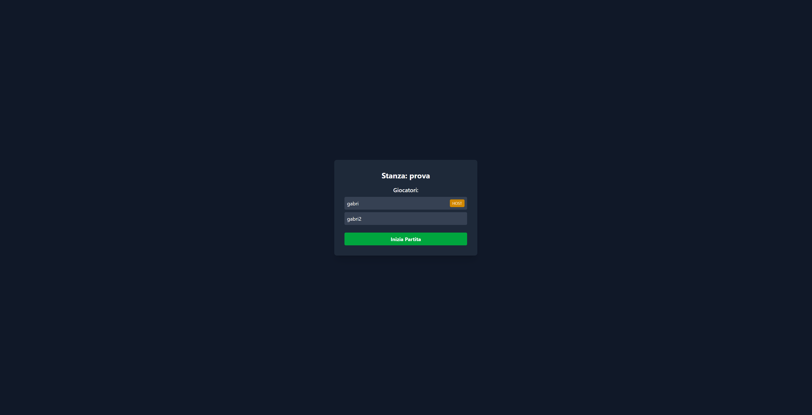
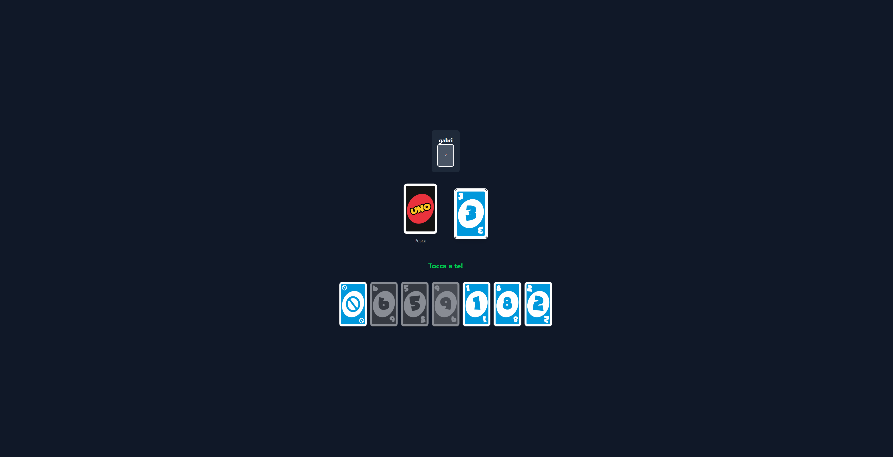
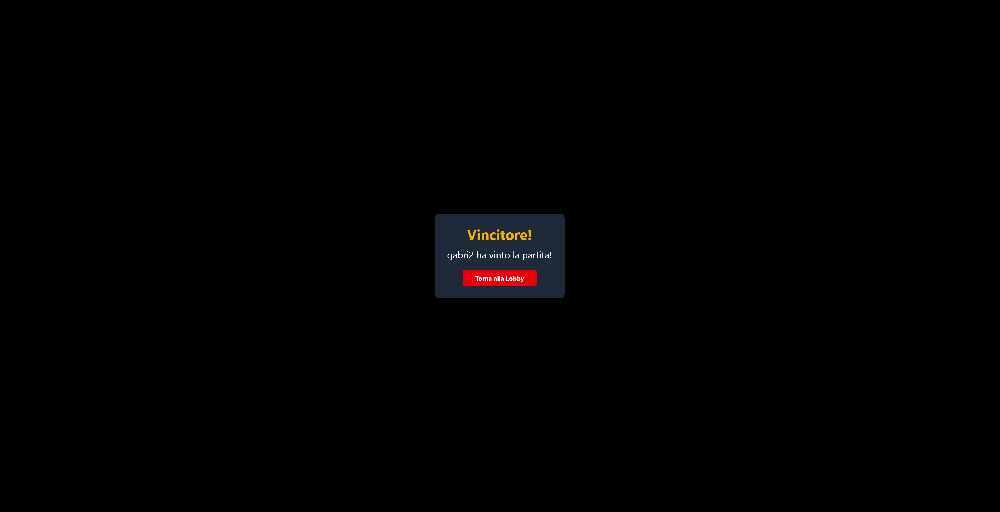

<div align="center">

# 🃏 UNO Clone Multiplayer

### Il classico gioco di carte, reinventato in tempo reale.

[](https://nodejs.org/)
[](https://vuejs.org/)
[](https://socket.io/)
[](https://www.mysql.com/)
[](./LICENSE)

**Gioca con gli amici. Nessun login. Solo UNO.**

[✨ Caratteristiche](#-caratteristiche) ·
[🚀 Installazione](#-installazione) ·
[🖼️ Screenshot](#️-screenshot) ·
[🛠️ Stack](#️-stack-tecnologico)

</div>

---

## ✨ Caratteristiche

| Funzione | Descrizione |
|---|---|
| ⚡ **Multiplayer in tempo reale** | Sincronizzazione istantanea delle partite tramite Socket.io. |
| 🎭 **Zero login** | Scegli un nickname, entra in una stanza e inizia a giocare. |
| 🃏 **Regole UNO** | Salto, Inverti, Pesca 2, Cambio Colore e Pesca 4. |
| 🏠 **Stanze multiplayer** | Più partite possono essere eseguite contemporaneamente e in modo indipendente. |
| 💾 **Persistenza MySQL** | Stanze e stato delle partite vengono salvati nel database. |
| 🎨 **Interfaccia moderna** | Frontend Vue 3 reattivo con animazioni e interazioni fluide. |

---

## 🖼️ Screenshot

<div align="center">

### 🏠 Lobby



<br><br>

### 🃏 Tavolo da gioco



<br><br>

### 🏆 Vittoria



</div>

---

## 🚀 Installazione

### Prerequisiti

Prima di iniziare assicurati di avere installato:

- 🟢 **Node.js** v20 o superiore
- 🐬 **MySQL** 8 o superiore
- 📦 **npm**

### 1. Clona il repository

```bash
git clone <URL_DEL_REPOSITORY>
cd uno-clone
```

### 2. Configura il database

Assicurati che MySQL sia in esecuzione.

Configura le credenziali nel file:

```text
server/.env
```

Esempio:

```env
DB_HOST=localhost
DB_USER=root
DB_PASSWORD=
DB_NAME=uno
DB_PORT=3306
```

> ✅ Il database e le tabelle vengono creati automaticamente al primo avvio del server, se previsto dalla configurazione del progetto.

### 3. Avvia il backend

```bash
cd server
npm install
node index.js
```

### 4. Avvia il frontend

Apri un secondo terminale:

```bash
cd frontend
npm install
npm run dev
```

### 5. Apri il gioco

Vite mostrerà nel terminale l'indirizzo locale dell'applicazione.

Solitamente:

```text
http://localhost:5173
```

Aprilo nel browser e crea una stanza. 🎉

---

## 🛠️ Stack tecnologico

<div align="center">

| Layer | Tecnologia |
|---|---|
| 🎨 **Frontend** | Vue 3 + Vite |
| ⚙️ **Backend** | Node.js + Express |
| ⚡ **Realtime** | Socket.io |
| 🗄️ **Database** | MySQL |
| 💻 **Linguaggio** | JavaScript |

</div>

---

## 📁 Struttura del progetto

```text
uno-clone/
├── assets/
│   └── cards/
│       └── demo.gif
│
├── docs/
│   └── screenshots/
│       ├── lobby.png
│       ├── game.png
│       └── winner.png
│
├── frontend/
│   └── src/
│
├── server/
│   ├── index.js
│   └── .env
│
├── LICENSE
└── README.md
```

---

## 🤝 Contribuire

I contributi sono benvenuti!

Se hai un'idea, trovi un bug o vuoi aggiungere una funzionalità:

1. Apri una **Issue** descrivendo il problema o la proposta.
2. Fai un fork del repository.
3. Crea un branch:

```bash
git checkout -b feature/nuova-funzione
```

4. Apporta le modifiche.
5. Crea un commit:

```bash
git commit -m "Aggiunge nuova funzione"
```

6. Fai il push:

```bash
git push origin feature/nuova-funzione
```

7. Apri una **Pull Request**.

---

## 🐛 Segnalazione bug

Hai trovato un problema?

Apri una Issue indicando, quando possibile:

- cosa stavi facendo;
- cosa è successo;
- cosa ti aspettavi che succedesse;
- eventuali errori presenti nella console;
- browser e sistema operativo utilizzati.

---

## 📜 Licenza

Questo progetto è distribuito sotto licenza **MIT**.

Consulta il file [`LICENSE`](./LICENSE) per maggiori informazioni.

---

<div align="center">

### 🃏 Fatto con ❤️ e tante carte colorate.

⭐ **Se ti piace il progetto, lascia una stella!**

</div>
